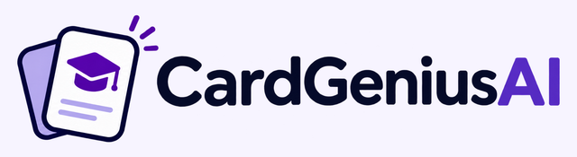
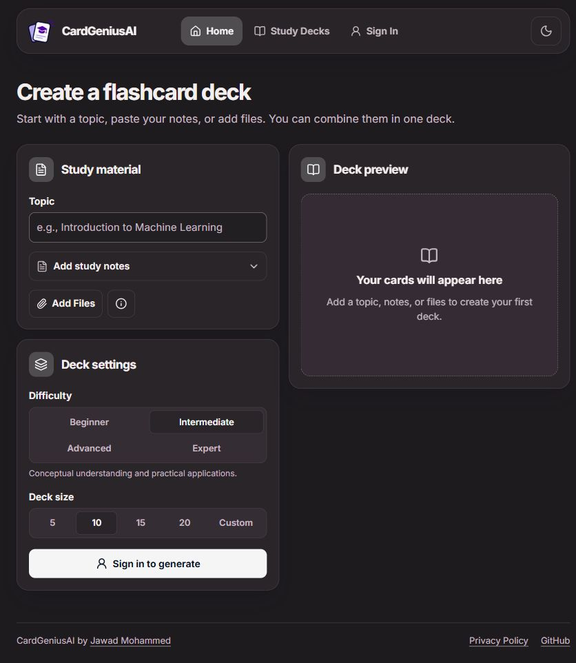

# CardGeniusAI



CardGeniusAI turns study material into flashcards you can organize, review, and export. Sign in to sync decks, folders, study progress, and preferences across devices.

[Open CardGeniusAI](https://cardgeniusai.vercel.app)



## Features

- Build decks from a topic, notes, PDFs (including legible scans), Word documents, or JPEG, PNG, and WebP images. Combine up to five attachments, with a limit of 2.5 MB per file and 3.5 MB overall.
- Choose from four difficulty levels and request 1–100 cards. Large decks run in batches and report progress. Short sources may produce fewer cards.
- Create folders while saving, move decks between folders, and choose a deck icon and color. Search the flashcard editor by question, answer, or card number and jump straight to the card you want to edit.
- Study in the preview or fullscreen, or flip the whole deck in All cards. Rate cards as Known or Needs Review, resume a deck in its saved order, or review missed cards.
- Customize study behavior, keyboard shortcuts and hints, card animations, and rating sounds in **Account settings → Study preferences**. An account syncs these settings, your decks, and study progress across devices.
- Personalize your profile and pick a custom avatar, an accent color, and Light, Dark, or Midnight.
- Open [Demo](https://cardgeniusai.vercel.app/demo) for a guided walkthrough. Study the prepared deck, move it into a temporary folder, and try appearance and study settings without signing in. Demo changes reset when you leave.

Hosted Gemini generation is for signed-in adults in the United States and Canada using it for professional learning or training. It uses a server-only Gemini key and a shared daily usage budget. [Gemini API terms](https://ai.google.dev/gemini-api/terms)

## Run locally

Use Node.js 22.18 or newer.

```sh
npm ci
```

Copy `.env.example` to `.env.local` and set the Supabase project URL, its publishable key, and a Gemini API key. Sign-in needs the Supabase configuration. Local generation uses your configured Gemini key.

```dotenv
NEXT_PUBLIC_SUPABASE_URL=https://your-project.supabase.co
NEXT_PUBLIC_SUPABASE_PUBLISHABLE_KEY=your_publishable_key
NEXT_PUBLIC_GOOGLE_SIGN_IN=false
GEMINI_API_KEY=your_gemini_key
# GEMINI_MODEL=gemini-3.1-flash-lite
HOSTED_GEMINI=false
```

```sh
npm run dev
```

Open [http://localhost:3000](http://localhost:3000). Keep `.env.local` out of version control.

## Supabase setup

1. Apply the SQL files in `supabase/migrations/` in order on a Supabase project. Apply pending migrations before deploying the matching app version. Ownership policies protect each account’s profiles, preferences, folders, decks, and cards.
2. Enable email/password authentication and confirmation. Set the minimum password length to 10. Configure a verified custom SMTP sender for public signup confirmations and password resets. Supabase’s built-in sender is limited to organization members. [Custom SMTP setup](https://supabase.com/docs/guides/auth/auth-smtp)
3. Set Supabase’s Site URL to the deployment’s canonical HTTPS domain. Allow `http://localhost:3000/auth/callback`, the production `/auth/callback`, and those exact callback paths with `?flow=recovery` for password recovery. The default email links use a same-browser PKCE flow. For cross-browser email links, use `/auth/confirm` in custom templates with `token_hash` and the appropriate `email` or `recovery` type. [Supabase redirect URLs](https://supabase.com/docs/guides/auth/redirect-urls) · [Email templates](https://supabase.com/docs/guides/auth/auth-email-templates)
4. For Google sign-in, configure a Google Web OAuth client using the Supabase Google provider’s exact callback URL. Save the client ID and secret in Supabase’s provider settings. Set `NEXT_PUBLIC_GOOGLE_SIGN_IN=true` after the provider is configured. [Google sign-in setup](https://supabase.com/docs/guides/auth/social-sign-in/auth-google)

The app uses Supabase Auth for credentials and stores resized avatar images in owner-protected profile rows. Account deletion removes those rows and associated decks and progress. CardGeniusAI does not require a service-role key.

If you used a previous local version, open that same localhost address in the same browser profile, sign in, and choose **Import browser decks** from Account. Browsers isolate local data by site, so the Vercel address cannot read decks saved on localhost. The importer preserves the original browser data and uses stable identifiers to avoid importing the same cloud deck twice. JSON exports include deck content and folder assignments. Browser-to-cloud migration also carries saved study progress.

## Study controls

Focus a deck’s study area and use **← / →** to move, **Space** to flip, **↑ / ↓** to rate, **C** to copy a card, **F** for fullscreen, **S** to shuffle, **R** to restart, and **Esc** to close the active dialog or exit fullscreen. Change the study shortcuts in Account settings and open **Keyboard shortcuts** in any deck to see the current bindings.

Auto-advance starts enabled for new profiles and respects existing profiles’ saved values. Rating sounds start muted and can be previewed at the selected volume in Study preferences.

## Deployment and checks

Import the GitHub repository into Vercel with the Next.js preset. Configure the Supabase publishable settings in the target environment. Add `GEMINI_API_KEY` as a sensitive server environment variable and set `HOSTED_GEMINI=true` for the approved launch audience. Update the Supabase redirect allowlist to match the Vercel domain.

```sh
npm run lint
npm run typecheck
npm test
npm run build
```

**Stack:** Next.js, React, TypeScript, Supabase Auth and PostgreSQL, IndexedDB for guest storage, and the Gemini Developer API.

**Roadmap:** Add optional spaced-repetition scheduling and richer review history.

**License:** [GNU Affero General Public License v3.0](LICENSE).
